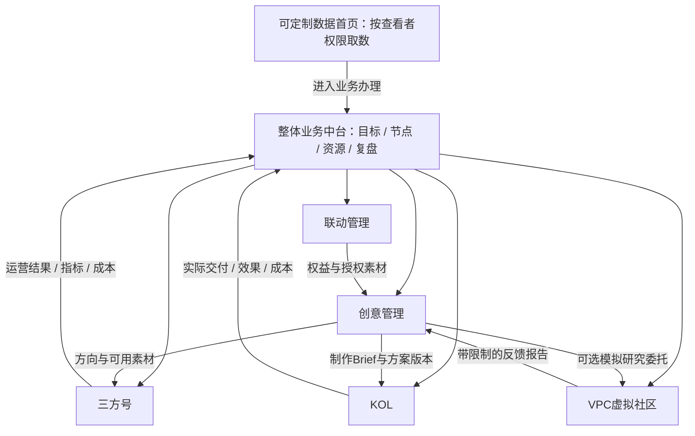
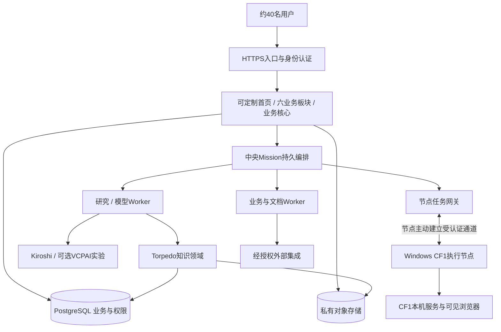

# ANANTA Mikoshi 综合平台设计提案

**状态：PROPOSED / 待用户审阅，未成为正式 Constitution。**

版本：0.2。日期：2026-10-18。产品与架构提案：Codex。调查基线：SBS-0002；本版修订：SBS-0003。

本版按用户反馈改为六个一级业务板块：三方号、KOL、联动管理、创意管理、VPC虚拟社区、整体业务中台。用户确认的是按业务重设计的方向；以下具体边界、二级页面、流程和技术建议仍待审。v0.1及其验收对应Git提交`1dc6760`，旧hash不适用于本版。

用户进一步要求：最开始有可编辑的数据大看板，大家可以自己定制。因此当前产品入口是**可定制数据首页 + 六个业务板块**。首屏需求已记录，具体组件、交互和技术实现仍是本版建议。

本文件讨论建议建设什么、怎样形成整体、怎样验证。它不授权目录裁剪、代码合并、部署、真实采集、模型调用或自动发布。文中的“应”“必须”是建议采纳后的设计要求；已生效的治理规则仍以 Constitution 现有正文为准。用户批准可以只批准其中一部分，须记录具体范围和版本。

先看 [易读 Brief](BRIEF.md)；证据和阅读边界见 [来源索引](../../../Product/research/2026-10-18-mikoshi/SOURCE_INDEX.md)。下面所有容量、SLO、成本上限、状态模型和技术选择均为提案，不能当成现有系统能力。

## 1. 建议建设的整体

Mikoshi 应成为《无限大》的业务综合平台。三方号、KOL、联动管理、创意管理、VPC虚拟社区各有完整的工作空间，整体业务中台负责跨业务目标、协作和经营总盘。人负责判断与承诺，业务对象记录真实进展，工作Agent承担受控执行，知识系统沉淀可追溯经验。

“无限大”体现为可以持续增加业务类型、工具和 AI 居民，而非先建一个没有具体业务的万能平台。40名用户不需要几十个微服务，但长期任务、多人权限、跨系统副作用和知识可信度需要认真设计。建议采用：

1. **六个业务入口，共享一个平台底座。** 用户先进入所负责的业务，在该业务内完成计划、资料、审批、执行与复盘；后端模块按状态责任划分，不复制六套登录、文件库和任务引擎。
2. **一个中央持久任务系统，多个专业执行池。** 用户任务、长等待、人工确认和恢复统一管理；采集、研究、文档、模型和重处理分别限流执行。
3. **统一身份与权限，领域知识仍由专业组件负责。** 人、Agent、执行节点有不同身份；不能拿一个管理员账号代表全部 AI。
4. **旧产品按能力进入业务。** OpenBP提供平台工作台基础，Torpedo服务各板块知识需求，CF1提供受控采集，Harness提供限定执行，Kiroshi提供观察证据；VCPAI优先作为VPC虚拟社区的技术资产候选。成熟度不同，接入节奏不同。

最终体验可以有“AI居民在数据中心里工作”的鲜明风格。可视化小镇、人物和房间是系统状态的表达；真正的任务、权限、费用与记忆应存放在可靠后端。视觉世界暂停或关闭时，任务仍应照常运行。

## 2. 调查得到的判断

### 2.1 可信度口径

以下调查基线来自SBS-0002：完整核读相关核心产品/需求/架构说明，并沿关键代码链路核验。v0.2复用该证据并按用户反馈修订设计，没有重新运行组件。没有逐行阅读全部依赖、历史输出、原始用户数据、二进制运行库，也没有把源码存在视为生产验证通过。原项目与当前副本有不同 Git HEAD；通过选定文件哈希比较识别内容一致和差异，不能只凭分支日期判断新旧。

证据分四类：**用户已确认**、**文档中的目标**、**源码可见实现**、**运行验证**。本轮没有启动各产品做新的运行认证；旧报告中的测试通过仅对当时版本和范围有效。

### 2.2 关键事实与设计影响

| 调查事实 | 对总设计的影响 |
|---|---|
| 工作盘点涉及 KOL、事件节点、三方号、伏羲、上影元、浙博、费用和排期 | 共同主线是传播项目、素材授权、合作任务、审批、发布、效果与费用，不能只做账号表 |
| 三方号原需求存在范围与规则冲突：B站/多平台、伏羲/供应商视图、达标或不达标后的处置 | 保留冲突，不把其中一段自动升级为全平台规则；通过规则版本与业务决定解决 |
| OpenBP 已有 Next/React、PostgreSQL/Drizzle、文档协作、员工/技能/工单等基础，也保留 JSON 影子与部分隔离缺口 | 可复用工作台和业务交互；不能直接开放40人，更不能照搬自动批准的写入路径 |
| Torpedo 已有证据、候选、正式知识、Job 和 Resident 设计；最新研究尾链仍有内部同步与接线限制 | 继承知识语义与领域合同，补生产调度/权限/恢复；不再造第二套“企业记忆” |
| CF1 包保持 Windows、可见浏览器与登录/任务确认合同；多平台并行资格和专家开关有明确限制 | 中央服务器与采集节点分离，先利用现有可靠路径；不能直接承诺无人值守全平台采集 |
| Harness 有限定执行、动作审批和未知结果保护；部分运行/审批状态为本机或内存实现 | 当作执行适配器，中央另管持久 Mission；不能承担全平台长驻任务管理 |
| VCPAI 有画像、模拟研究价值，也存在 WebSocket token 非空检查及对象授权需要补齐的路径 | 作为VPC虚拟社区的接入候选；先补隔离，持续社区演化另验，合成人群不能冒充真实用户效果预测 |
| Business Map 是业务与表现原型，未接通真实后台/发布/Agent | 提取“环节、角色、规则、输入输出、回填”设计，不照搬成万能节点引擎 |

详见 [业务与 OpenBP](../../../Product/research/2026-10-18-mikoshi/BUSINESS_AND_OPENBP.md)、[运行时与研究](../../../Product/research/2026-10-18-mikoshi/AGENT_RUNTIME_AND_RESEARCH.md)、[CF1 与 Business Map](../../../Product/research/2026-10-18-mikoshi/CRAWLER_AND_BUSINESS_MAP.md)、[Torpedo 与技术依据](../../../Product/research/2026-10-18-mikoshi/TORPEDO_AND_TECH.md)。

## 3. 六个业务板块：入口、职责与日常工作

### 3.1 首屏：每个人都能定制的数据大看板

登录后先到“我的数据看板”，用自己关心的数据组织首页；再由侧边导航进入六个业务板块。首页是全局入口，不增加第七个业务域，也不取代整体业务中台的项目统筹和业务办理。

每个成员都可编辑自己的看板，无需管理员代配。首次登录可选岗位模板，也可从空白开始；系统建议的默认模板只作为起点。将“编辑看板”作为明确模式，平时是查看模式，避免点击指标时误拖布局。

| 可定制内容 | 建议交互与规则 |
|---|---|
| 数据组件 | 从组件库添加/删除/复制卡片，选择所属业务、指标与对象范围 |
| 页面布局 | 拖拽位置、调整大小、分组、排序、折叠；小屏按顺序重排，可选全屏大屏模式 |
| 图表展示 | 在该指标支持的数字卡、趋势、柱形、表格、日历/待办等形式之间切换，配置标题与合法维度 |
| 筛选与周期 | 全局选择项目/业务/时间范围；单卡可覆盖，全局和局部口径均在卡片上可见 |
| 多份看板 | 保存“日常总览”“某节点作战”“本月复盘”等命名版本，设为个人默认 |
| 个人与团队 | 普通成员可维护个人版；获授权成员可发布/编辑团队版或共享为模板，成员可复制后自行调整 |
| 保存与恢复 | 编辑草稿自动保存，明确显示保存中/已保存/失败；提供预览、发布、撤销和恢复模板，已发布版本不被失败草稿覆盖 |

模板候选：总负责人关注节点/风险/费用；账号运营关注待审/发布/缺数；合作负责人关注锁档/监修/履约；研究人员关注社区实验/报告/费用。模板不改变角色权限，也不把缺数据的模块伪装为已接通。

组件库优先覆盖各业务真实需要：三方号更新与效果、KOL交付/锁档、联动监修/权益到期、创意提案/制作进度、VPC虚拟活动/实验、跨业务节点/预算，以及本人待办、审批和工作Agent任务。组件读取来源记录或受控汇总，不让每张卡另算一套业务口径。

每张数据卡至少有指标名称、口径/单位、项目与时间窗、来源更新时间、数据状态和下钻入口。展示“未接入、无数据、部分数据、更新失败、无权限”等真实状态，不能回退演示数或把缺数当0。真实发布效果、计划目标、费用估算和VPC模拟数据明确区分，不混合成一个总效果数。页面刷新时间不能冒充来源采样时间。

“可编辑”默认指布局、组件、指标选择、筛选和展示配置。原始费用、账号数据、发布状态等仍由所属业务办理；卡片可链接有权限的业务编辑页，但不能直接改显示数字来伪造事实。用户自写说明/目标卡明确标为手工备注或计划，保留作者，不冒充自动取数。需要自定义计算时采用已登记公式/指标版本，不开放任意SQL、脚本或未经审核的全库查询。

个人看板跨设备保存在服务器，localStorage只可作临时缓存。团队版修改需要编辑权限和期望版本，冲突保留草稿供合并/另存，不静默覆盖；共享模板升级不强行改掉成员已定制的个人版。团队看板布局共享不代表数据共享：每次取数、下钻、导出及缓存命中都按当前查看者授权过滤，卡片配置中的项目名/对象标签也不得泄漏无权元数据。

刷新使用限频的读模型/数据查询，不触发模型思考或重新采集。采集更新是有权限、有预算的独立业务动作；频繁打开大屏不能自动增加CF1任务。查询超时保留上次可见结果并标记过期/失败，撤权后清除不可见缓存。首页上线前须证明：两个人定制互不覆盖、重登配置仍在、团队并发编辑有冲突提示、共享布局不越权、缺数和模拟标记不丢失。

### 3.2 六板块总体导航

一级业务菜单采用用户提出的六板块。数据首页在最前；搜索、我的待办、通知、系统设置为全局辅助入口。资料、审批、费用、AI等共用能力嵌入具体业务，不再要求用户先按工具类型寻找工作。

| 一级业务板块 | 业务核心 | 建议二级入口 | 主要使用者 |
|---|---|---|---|
| 三方号 | 一批账号怎样持续稳定地产出和运营 | 业务总览、账号/供应商、运营计划、内容生产与审核、发布日历、数据/整改 | 账号运营、供应商对接人、伏羲业务对接人 |
| KOL | 某位达人围绕一次合作交付什么、效果和成本怎样 | 达人库、需求/选人、比选/报价、合作单/锁档、内容交付、效果/复盘 | KOL项目负责人、采购/合作对接人 |
| 联动管理 | 某次IP/机构/品牌合作的权益、监修和履约怎样完成 | 联动项目、伙伴/权益、产品与传播计划、素材/监修、履约、费用/续期 | 联动负责人、商务、产品、法务/监修参与人 |
| 创意管理 | 需求怎样变成可执行的创意，哪些值得采用 | 需求Brief、洞察/灵感、创意提案、评审/验证、制作Brief/交付、案例/复盘 | 策划、创意、设计、内容与业务审核人 |
| VPC虚拟社区 | 虚拟玩家和圈层如何互动，能提供什么研究反馈 | 社区总览、玩家/圈层、话题/活动、访谈/实验、反馈报告、运行历史 | 研究、策划、社区运营人员 |
| 整体业务中台 | 各业务怎样围绕共同目标推进，资源和风险怎样协调 | 业务总盘、总项目/节点、跨板块协作、费用/资源、综合效果、知识/AI运营 | 总负责人、项目统筹、各业务负责人 |

这里的页面是提案级功能组织，不代表每页首期都开发，也不等于六个独立系统。一个用户可以有多个板块角色；登录首页使用其自选默认看板，并能快捷进入常用板块。面向总负责人的跨板块视图按数据权限汇总，不能因“看总盘”自动读取全部私密合同或研究原件。

VPC沿用用户本轮的界面命名，现有技术资产仍称VCPAI；不据此改仓库、目录或协议名称。

### 3.3 三方号：以账号和运营周期为中心

核心工作单元是“账号 × 运营周期/节点任务”。进入后先看到缺稿、待审、今日发布、数据缺口和需要整改的账号，再进入具体账号的完整运营档案。

主链：账号/供应商及运营人入库 → 定位与运营计划 → 日常或节点内容任务 → 制作/审核 → 排期/发布回执 → 指标批次 → 复盘与调整。首期建议在该板块中用业务线区分供应商运营与伏羲协作，各自保留规则和资源约束；是否以后独立伏羲板块另讨论。

该板块管理账号归属、运营状态、周期计划、内容任务、发布和质量整改。供应商组织/人员、素材、费用和审批使用公共记录。采购手机号、注册、可发布、持续更新、达标是不同事实，不能被一个“正常”状态吞掉。普通内容、重点选题、月度方案按已有业务要求配置不同关口。

收到创意管理的制作Brief和可用版本后，三方号负责账号适配、日常选题、稿件版本、排期与发布；日常小选题可在本板块完成，不强制每篇都新建跨板块创意项目。向中台回传真实交付、指标和费用归属，向创意回传素材/选题效果。

候选工作Agent：账号巡检、数据查漏、内容助手。它们可提出任务/草稿和异常说明；账号回收、供应商处置、未确认KPI及发布动作仍按权限与规则办理。

### 3.4 KOL：以达人合作单和约定交付为中心

核心工作单元是“达人合作单 × 约定交付”，不是接管达人的账号日常运营。达人库记录人、账号、风格、历史合作、可用档期与证据；一次合作另建目标、报价、权益、交付、节点、验收和费用关联。

主链：业务需求/传播节点 → 人选池与理由 → 比选/报价/锁档 → 合作约定 → 创意与内容协作 → 送审/交付 → 发布回执/效果 → 验收/结算引用/复盘。报价版本和有效期保留，锁档意向不自动等于已签约。

KOL负责人拥有合作单及交付验收责任。创意管理可提供方向/制作Brief；达人自身提案也可直接成为该合作单的创意版本。联动素材需继承其权利和监修要求；达人稿件通过内部内容审核不自动代表IP方监修通过。

KOL账号可引用公共账号/达人身份，与三方号没有两套同名人员库；同一达人兼做三方运营时，两类业务合同与交付各有归属，不因账号相同就合并责任或重复计费。KOC、媒体等是否纳入本板块是后续范围选项，本版不承诺全量覆盖。

候选工作Agent：人选资料整理、报价差异检查、锁档/交付追踪、效果复盘。选人推荐附来源与未知项，不把模拟人群偏好当成真人影响力数据。

### 3.5 联动管理：以权益、监修和履约为中心

核心工作单元是“联动项目 × 具体权利/履约义务”。覆盖上影元、浙博这类已有合作背景，并可扩展IP、机构、品牌联合及关联线下活动；普通供应商采购仍在其业务合作单，不一律升级成联动项目。

主链：合作机会/目标 → 权益与限制谈定 → 产品/内容/传播/线下交付分工 → 素材授权 → 监修与返修 → 版本批准 → 实际履约 → 费用、期限、复盘/续期。

每项权益记录使用对象、渠道、地区/时间、可否改编/转交、监修要求、承诺与证据。产品侧版本/功能交付、商务/法务确认和传播执行各有责任人，营销负责人不能代替全部专业批准。端内内容和线下活动可挂本联动项目的履约工作包；需跨多业务统筹时再关联中台节点。

向创意、KOL和三方号交付可用素材版本与限制，不只发一个共享文件夹。授权到期/变更形成影响清单，由使用方处理排期和已发布内容；联动模块拥有权利事实，其他模块不能自行改成“可用”。

候选工作Agent：权益清单整理、监修意见比对、缺件与到期巡检。对外承诺、合同判断、权利确认及最终监修由相应责任方裁定。

### 3.6 创意管理：从问题和构想到可执行方案

该板块管理“想做什么、为什么、怎样表达、交给谁做”，不是只存图片和成片。核心对象是需求Brief、洞察、创意提案及其版本、评审决定、制作Brief和案例复盘。

主链：接需求与约束 → 查产品事实/受众/现有案例 → 发散创意 → 方案比较 → 必要的模拟/真人验证 → 选择与细化 → 制作Brief → 业务交付 → 复盘。允许创意被暂缓、淘汰或复用，记录原因，不让草案直接变成生产任务。

需求Brief包含目标、受众、传播节点、预算区间、玩法/版本事实、可公开时间、品牌表达、可用素材与禁用项；产品事实与公开时间由被指定的事实负责人确认，创意作者只引用其版本。创意提案记录切入点、关键表达、载体、制作可行性、风险和预计资源；评审通过的是具体提案版本。

制作Brief明确母素材、脚本/视觉方向、版本、验收标准和接收板块。KOL/三方号可产生各自渠道衍生版本，不回写覆盖创意母版；方向发生实质变化时回创意负责人重新评审，渠道适配不重复整个立项。底层文件和版本由公共素材服务保存。

可从VPC请求限定范围的虚拟反馈，或从CF1/Torpedo取得真实来源证据；两者分类呈现。VPC反馈支持提出问题和筛选思路，不能自动决定创意通过，更不能代替真实受众验证。

候选工作Agent：洞察整理、创意发散、方案对比、Brief查漏、案例检索。作品入库不等于采用，采用不等于允许发布。

### 3.7 VPC虚拟社区：社区运营和研究实验并存

该板块是独立的虚拟玩家业务空间。可维护虚拟玩家档案、圈层、话题、讨论/访谈、活动和实验，观察不同设定的玩家对内容和游戏信息怎样响应。界面应始终标记“虚拟/模拟”，不能用社区活跃度制造真实用户规模印象。

有两种工作方式：**社区模式**在预算与时间窗内安排话题和互动，积累可追溯的模拟历史；**实验模式**冻结玩家样本、画像版本、方案版本、模型配置与条件，运行访谈/对比并生成报告。社区长期状态可供实验选择快照，但不能边跑边改样本再声称可比较。

现有VCPAI可复用候选是画像来源、问答/群聊模拟、冻结实验和复算方法；长期关系网络、跨日状态演化、自主话题与连续社区运行是新增候选，尚无本轮生产实现证据。先验证一个可暂停、恢复、控费和回放的小社区，再讨论长期演化规模。

主链：建立/选择社区与样本版本 → 设定话题或研究问题 → 批准范围/预算 → 模拟互动 → 检查异常、缺答与偏差 → 报告 → 业务人员采纳/拒绝并记录理由。可接创意方案比较、KOL人设/表达假设、联动接受度等问题，但反馈不能伪装成销量预测、真实市场比例或因果结论。

虚拟玩家是模拟角色，不拥有平台员工权限；主持研究的工作Agent才是受组织授权的执行者。玩家的模拟记忆/关系归VPC领域，工作Agent经验和正式业务知识按Torpedo治理，不把虚拟发言直接晋升为事实。日常对话和实验都消耗同一预算体系，等待时不持续调用模型。

候选二级管理项包括社区活动时间窗、暂停/重启、样本/模型版本、每次运行的费用与失败明细；这些是社区运营能力，不是把全平台Agent控制台搬进VPC。

### 3.8 整体业务中台：跨板块目标、协调与经营总盘

中台服务总负责人和跨业务协作者，独立拥有总项目、传播节点、跨板块工作包、依赖、责任承诺和综合决策。它管理“一次传播有哪些业务一起参与、共同截止时间是什么、资源冲突谁裁定、钱和结果如何汇总”。

建议六类日常入口：业务总盘、总项目/节点、跨板块协作、费用/资源协调、综合效果与复盘、共享知识/AI运营。审批收件箱汇集各域的申请，处理时仍由该域验证审核资格、对象版本与状态；中台不能给自己一项万能批准权限。

主链：总目标与节点 → 选择参与板块并下发工作包 → 责任人接单/反馈条件 → 协调资源与依赖 → 汇总阶段结果 → 处理风险/变更 → 成本与成效复盘。业务内日常运营可独立进行，只有存在跨域目标或依赖时才关联总项目，不把每篇普通稿都强制升级成大项目。

三方号运营、达人合作、联动权益、创意版本、VPC实验由各板块维护唯一状态。中台汇总这些记录并提供跳转和获权操作，不另建影子账号表、合作单、稿件或实验记录。总项目经批准的目标/日期变化生成变更请求，由受影响板块确认后执行；取消总项目也不等于自动解除合同或撤销已发生的发布。

跨板块的资料/知识搜索、共享Agent名册/配额/异常接管在中台提供管理入口；各业务同时有“本业务资料”“本业务AI”和任务侧栏。系统设置仍是全局辅助入口，管身份、节点与运维。界面上的整体业务中台，与支撑全部板块的公共技术底座是两个概念；没有第七个业务系统。

### 3.9 业务地图与共同体验



图中业务箭头表示任务或产物交接，不是强制导航顺序；首页可直接进入任一有权限的板块。关联不表示获得对方全部数据权限。每个板块有自己的总览、筛选与日常业务页；共用项目关联、资料选择、评论、审核、版本、费用、Agent任务和通知组件。列表和详情默认留在业务上下文，跨板块关联可直接展开来源。

“小镇/机房”可作为社区或工作Agent的可选表现形式。VPC展示的是模拟社区状态；中台的工作Agent视图展示实际任务状态。两者清楚标识，不能用随机动画伪装任务进度。

## 4. 业务共同对象与责任

### 4.1 先把对象建对

| 领域 | 一等对象 | 权威状态由谁维护 |
|---|---|---|
| 三方号 | AccountAssignment、OperationCycle、ChannelPlan、ChannelDelivery | 三方号模块拥有运营和交付状态，引用公共账号身份与发布回执 |
| KOL | CreatorProfile、CollaborationOrder、Booking、Deliverable | KOL模块拥有合作与约定交付；报价/锁档/验收分开 |
| 联动管理 | AllianceProject、RightsGrant、Obligation、SupervisionDecision | 联动模块拥有权益、监修和履约事实；商务/法务/产品/监修分别确认 |
| 创意管理 | CreativeRequest、Insight、ProposalVersion、CreativeDecision、ProductionBrief | 创意模块拥有提案与取舍；引用被指定事实负责人确认的产品事实和公开时间 |
| VPC虚拟社区 | Community、VirtualPlayerProfile、PopulationSnapshot、Topic、Experiment、SimulationEvent | VPC域拥有模拟状态和实验事实；不写真实业务效果或工作Agent授权 |
| 整体业务中台 | Project/Campaign、Milestone、CrossBoardWorkPackage、Handoff、Dependency | 中台项目模块拥有跨域目标/关系；各业务进展是来源投影 |
| 公共身份与资源 | Partner、Person、Account、Membership、ResourceReservation | 统一资源/身份服务；各业务关系独立，资料权利不因复用身份而扩大 |
| 公共内容能力 | ContentVersion、AssetVersion、ReviewRequest、Publication、EffectReceipt | 内容服务维护版本/回执一致性；请求所属业务决定使用范围、审核资格与业务完成 |
| 费用归属 | CostCommitment、CostAllocation、CostApproval、SettlementReference | 费用模块；首期不执行付款或替代财务账套 |
| 研究知识 | CollectionRequest、EvidenceRef、ResearchReport、KnowledgeProposal、KnowledgeVersion | 采集域/Torpedo分别负责来源与正式知识 |
| 自动化 | AgentIdentity、Mission、ExecutionRecord、ActionIntent、Approval | 中央任务/策略入口关联唯一执行权威；域内Job/Run仍由域管理 |
| 数据首页 | Dashboard、LayoutVersion、WidgetConfig、Template、MetricDefinitionRef | 看板服务拥有配置/分享；指标定义由来源业务或受治理的综合指标维护，不反写事实 |

对象默认具有稳定ID、所属组织/项目、创建者、责任人、版本号、状态、时间与来源引用。不得用标题或文件路径作为跨模块唯一身份。时间存储使用带时区时间点，业务显示按项目时区；人民币费用用整数分和币种字段，不让模型或浮点数决定金额。

业务事实、原始文件、AI推断和汇总指标分开存放。指标保留平台、账号/作品、采样时间、统计窗口、来源快照、指标口径版本和缺失标记；未取到数据不能当0。跨平台指标只能在明确映射后汇总。

### 4.2 三条容易出错的关系

- **账号不是登录用户。** 供应商可服务多个账号，人也可负责多个账号；账号凭据由执行节点保管，前台只显示引用和授权状态。
- **任务完成不是发布成功。** Agent 写好了草稿，只能完成起草任务。发布要有平台回执或经授权人工记录的证据；费用结算也有独立状态。
- **知识发布不是素材发布。** Torpedo 审核后的知识版本可供内部引用；对外稿件仍需要内容/授权检查，不能共用一个“已批准”布尔值。

创意评审、产品事实确认、IP监修、发布授权也分别记录。共享审批引擎负责收件箱、冻结载荷和审计，不把这些决定压成一个全局approved字段。

一个账号、伙伴或素材可被多个板块引用，但各自工作单和授权范围独立。一个发布回执关联多个贡献来源时只记录一次实际发布；一项成本可分摊，但分摊合计不能增加总额。综合看板与数据首页展示聚合结果，不再创建“中台版”事实行。

### 4.3 Business Map 的“芯片”怎样落地

建议把芯片定义为可版本化的**业务能力合同**。例如“检查素材授权”“生成审稿包”“登记发布回执”“产出周报”，每块声明输入、输出、责任角色、使用工具、权限、费用上限、人工关口、幂等策略、失败/补偿方式和验收。

首期使用工程定义的少量模板组合，表单允许业务填写参数，不开放任意脚本或任意拖拽执行。KPI、日期、授权期限、预算校验由确定性规则执行，模型只提出建议或解释。规则先试运行、展示影响、经有权限的负责人发布后才生效；旧任务继续引用原规则版本，改版需要显式迁移。

未来如重复场景足够多，再做可视化编排器。界面配置的是有合同的能力，不能成为绕过类型、权限、审核和测试的第二条开发路径。

### 4.4 跨板块交接合同

交接统一记录源/目标业务对象ID、具体版本、目的、发送人与接收责任人、交付物引用、验收条件、权限/使用范围、期限、费用分配及回执。发送只是待接单，接收方可接受、要求补充或拒绝并说明原因；超时提醒不自动算接单或完成。

| 交接 | 接收方得到什么 | 仍由来源方决定什么 |
|---|---|---|
| 联动 → 创意/KOL/三方号 | 授权素材版本、允许渠道/期间/改编范围、监修条件 | 权利变化、监修决定；不能被接收方自行放宽 |
| 创意 → KOL/三方号 | 采用的方向、制作Brief、素材引用、验收标准 | 母方案实质变更；渠道稿与发布由接收板块办理 |
| 创意/其他业务 → VPC | 研究问题、可展示材料版本、样本/条件与预算请求 | 原需求和素材授权；VPC负责实验设置/回执，报告不会自动批准方案 |
| VPC → 委托业务 | 带样本来源/版本、运行条件、失败和局限的模拟报告 | 模拟记录不可被改写成真实效果；采纳理由由业务人员记录 |
| 中台 → 各板块 | 总目标/节点、工作包、依赖和预算约束 | 中台拥有总目标；业务接单后拥有本域执行及交付事实 |
| 各板块 → 中台/数据首页 | 有版本和来源的状态、成果、成本/指标引用 | 各域状态由各域修改；首页配置只选择展示与筛选 |

变更和取消传播为有版本请求，列出受影响项。接收方评估并确认，不无条件覆盖已排期或已签约事项。交接只授予明确资料和动作范围；加入同一总项目不会自动取得所有关联业务的完整权限。

## 5. 跨板块业务闭环

### 5.1 传播节点：建议首个纵向验证场景

候选试点仍建议选一个真实传播节点：中台明确目标，联动提供已批准权益/素材（如涉及），创意形成方案与制作Brief，KOL和三方号分别交付，再回中台复盘。VPC验证按需要选用，不要求每个节点经过全部六板块。首期优先级仍待用户确定。


开始条件：项目/负责人/范围已确定，素材可用，合作与账号映射有效。每个交付要绑定内容版本、使用权、发布渠道和责任人。审稿后文本或素材变更使原批准失效，排期冲突进入协调待办。平台结果未知时暂停该动作并对账，不自动再次发布。

完成条件：执行SPEC定义的必需交付有证据、指标可追溯、费用不重复、复盘区分事实与推论。取消和未完成项单列，不因“已有责任人”就算闭环通过；样本数量在选择试点后确定。第一期可使用人工发布回执和受控导入；之后再扩自动发布工具权限。

### 5.2 三方号/伏羲：从账号管理到持续运营

账号及供应商入库 → 责任/可见范围确定 → 内容计划 → 稿件与素材检查 → 版本审核 → 排期 → 发布回执 → 分批指标回收 → KPI解释与处置建议 → 负责人决定整改、调整或回收。

同一后台可配置视图，但伏羲流程和供应商流程是否共享状态机要由业务核对，不能仅因表格长得相似就合并。原需求中“达标收回”和“不达标整改/回收”冲突保留为待裁定规则。新系统首期不自动执行账号回收，也不在未确认分类口径时自动做供应商排名。

Agent 可巡检缺稿、临期和异常数据，生成有来源的待办；不会因为一次采集失败就断言账号掉量。人工修正指标必须保留原始批次、修正原因及操作者。

### 5.3 IP/机构合作：权利、监修、交付和费用

合作目标 → 权利与资源清单 → 档期和费用承诺 → 素材提案 → 对方/内部监修 → 版本锁定 → 对外交付 → 使用范围与到期追踪 → 复盘归档。

上影元、浙博等不同合作先用共同对象表达，再保留各自审批路径、交付要求和限制。素材能否公开、能否二创、能否供供应商使用、有效期多久，应成为可查询约束。撤回授权时阻止后续使用并列出已发布影响清单，不虚构“撤销全部外部传播”能力。

费用承诺、审批、实际结算引用分离；AI可归集和查漏，不自行改变合同金额或对外承诺。首期以附件和财务系统单号关联，是否对接财务另立后续规格。

### 5.4 情报研究：CF1采集进入业务判断

业务提出问题 → 定义范围/预算/用途 → CF1准备与确认合同 → 指定节点完成登录确认 → 后台采集 → 检查结束条件并冻结集合 → Kiroshi等处理证据 → Torpedo研究与候选报告 → 负责人采纳 → 生成业务待办或知识提案。

采集完成不等于研究可信。报告必须给出样本范围、时间、缺失、来源和引用；“没有抓到”不能写成“市场不存在”。VCPAI可作为带明确实验标记的补充假设检验，不能与真实行为指标混表。

已冻结的证据集合不可被“补几条更好看数据”静默改变。新增数据生成新集合/版本，报告引用可重现的快照。采集账号过期、节点离线或结果未知时，责任人能在首页待办、本业务工作页与中台异常汇总看到需要处理的动作。

### 5.5 居民日常整理：持续服务而非持续空转

来源变更、每日时间窗或人工委派 → 知识管家检查授权范围内的变化 → 查重复/过期/缺来源 → 生成整理提案 → 自动通过允许的低风险规则或进入审核 → 发布知识版本 → 通知订阅者/产生工作待办。

只读摘要、去重建议可在预算内自动执行；删除原件、改正式口径、修改权限、对外发布和新增高成本研究需要相应授权。维护任务没有积压时休眠，连续无有效产出时降频或停用。Dream 使用同一任务、权限、预算与审计系统。

### 5.6 创意与VPC：提出假设、验证、再交付

创意Brief → 两个或多个有版本的候选方案 → 可选VPC研究委托 → 冻结样本/配置 → 模拟讨论或访谈 → 报告局限与意见 → 创意负责人采纳/拒绝及修订 → KOL或三方号小范围真实交付 → 对照真实证据复盘。

VPC结果是研究产物，不直接修改CreativeDecision或发布状态。模拟缺答、模型顺序敏感和样本信息不足均进入报告；不得只挑支持方案的发言。后续真实表现可成为新实验校准材料，先检查来源与使用权限，不回写改造原实验历史。

### 5.7 运营反馈反推创意：避免单向派单

三方号或KOL发现效果变化/内容机会 → 保留原指标批次 → 提交创意问题与假设 → 创意比较方案（必要时委托研究/VPC） → 原业务实施小范围调整 → 回填真实结果 → 复盘或继续保留不确定性。

平台同时保存“发生了什么”“我们猜为什么”“实际试过什么”，不会让一条AI解释直接改KPI或自动淘汰合作方。

## 6. 人员、身份与权限

### 6.1 组织模型

首个部署按一个内部组织、多个项目/小组设计，约40名人员。不把多公司 SaaS 计费/租户运营纳入首期，但核心数据保留组织边界，避免以后只能靠拼库扩展。供应商是否直接登录尚未确认；默认由内部对接人管理，后续若开放，使用明确的外部协作者角色。

| 身份/角色 | 默认可以 | 默认不可以 |
|---|---|---|
| 普通成员 | 查看被授予的项目，处理本人任务，提出稿件/研究请求 | 浏览所有供应商费用、其他项目研究和全部员工任务 |
| 项目负责人 | 分配本项目工作、审批其权限内交付、查看项目汇总 | 修改组织角色、越过其他项目权限 |
| 内容/合作/知识审核人 | 在被委派领域批准特定版本 | 一次批准未来所有版本或所有工具动作 |
| 创意/研究负责人 | 选择提案、签发制作Brief或受控VPC实验，维护各自业务范围 | 把创意通过当产品事实确认，或给虚拟玩家授予员工权限 |
| 费用负责人 | 审批授权范围金额、分摊与结算引用 | 因费用角色自动获得全部研究原始资料 |
| 平台管理员 | 维护用户、节点、集成、运行配置 | 默认读取所有业务私密内容；特权访问须有独立受控流程 |
| 外部协作者（后续可选） | 查看明确分享的任务、文件和自己提交的版本 | 搜索整个组织、看到内部费用与其他供应商信息 |
| Agent/执行节点 | 使用当前任务赋予的短时能力 | 共享人的管理员会话、自行扩权、无限继承用户权限 |

权限由组织成员资格、角色、项目成员关系、对象级授权、资料分类和动作共同决定。委派能力是 Agent 固有权限与委派人当前权限的交集，还要受任务范围和预算限制。将对象ID藏起来不算授权。

### 6.2 登录和授权落点

优先接企业已有 OIDC 身份源；没有现成来源时评估 Keycloak。浏览器持有安全会话，后端校验会话与动作，不把节点凭据或模型密钥发给前端。身份源负责认证，业务授权仍在 Mikoshi；OIDC 端点依据见 [Keycloak 官方说明](https://www.keycloak.org/securing-apps/oidc-layers)。

后端入口、领域服务、异步任务开始和副作用提交时都检查权限；WebSocket/SSE 订阅、导出、文件下载、搜索/RAG、缓存命中同样受对象权限约束。权限撤销后禁止新执行和结果泄漏，对正在执行的外部动作进入取消/对账流程。

PostgreSQL RLS 建议作为第二层隔离，不替代业务校验。应用连接使用非 owner、非 BYPASSRLS 角色；连接池事务内设置可信服务端上下文并确保归还前清理，不能使用浏览器传来的组织ID直接赋权。表 owner/superuser 的绕过规则需纳入测试，依据 [PostgreSQL 官方 RLS 文档](https://www.postgresql.org/docs/current/ddl-rowsecurity.html)。

搜索只返回用户当前可见的证据；向量相似度不能绕过 ACL。生成答案保留证据权限标记，转发/导出时重新检查。缓存按用户授权范围或等价权限集合隔离；撤权时失效。服务端管理员连接不能成为日常检索捷径。

## 7. 后端与部署边界

### 7.1 推荐技术路线

| 层 | 推荐 | 理由与边界 |
|---|---|---|
| 工作台与业务核心 | 延续 OpenBP 的 TypeScript / React / Next 基础，形成一个模块化应用 | 降低界面与文档工作台重写；先核对依赖/许可证和当前安全路径，再确定固定版本 |
| 主数据 | PostgreSQL，按模块 schema/仓储边界管理，迁移版本化 | 多人事务、并发与约束；移除生产 JSON 双写真相源，不直接全盘搬旧表 |
| 文件与证据 | 私有 S3兼容对象存储 + PG元数据/版本/ACL | 大文件离开数据库和Git；下载经鉴权签发短期访问，不公开桶 |
| 中央持久编排 | 首选 Temporal，采用前做有限验证与运维裁定 | 处理等待人审、重启恢复、长任务；生产托管或自建单独评估 |
| 专业计算 | Python/现有语言的独立 Worker，必要时保留领域 API | 复用 CF1、Torpedo、Kiroshi 等；不为统一语言重写成熟实现 |
| 搜索 | 先权限过滤的元数据/关键词检索，语义检索按中文召回基准选配 | 不先建多套索引；pgvector等只是候选，需用真实中文资料验证 |
| 分析 | PG聚合/读模型，必要时受控 DuckDB 分析快照 | DuckDB不承担40人业务写入与身份主库 |
| 身份 | 企业OIDC优先，自托管身份服务备选 | 避免再维护一套弱密码体系 |

Next 路由不应直接混写全域表：入口负责身份、参数和返回合同，应用服务编排同域用例，领域规则维护状态转换，仓储负责持久化。专业组件若保留 FastAPI，可作为其领域适配层；不为了“架构完整”再增加一个重复的全平台 BFF。长期任务不放在网页请求、进程内 BackgroundTasks 或个人电脑的定时脚本中；相关区别见 [FastAPI 后台任务说明](https://fastapi.tiangolo.com/tutorial/background-tasks/)。

### 7.2 逻辑拓扑



图是目标边界，不表示今天已连通。初期业务模块可在同一进程，专业 Worker 可部署于同一服务器不同容器；CF1维持独立 Windows 节点。数据库可同一实例、不同 schema/数据库与角色；Temporal 的内部存储与业务表分开管理，业务代码不查询或修改编排引擎内部表。

### 7.3 编排选择必须只有一个中央答案

**推荐 Temporal 的原因**是长等待、人审、恢复与升级复杂度，而非40人吞吐。工作流历史帮助恢复执行，但 Activity 的外部副作用可能重复，仍需幂等与对账；依据 [Workflow Execution](https://docs.temporal.io/workflow-execution) 和 [Activity Execution](https://docs.temporal.io/activity-execution)。

采用前验证：等人工审批数天后重启恢复、重复事件、Worker中途退出、CF1未知结果、权限撤销、在途工作流升级、备份恢复，以及部署/运维费用。工作流历史只存稳定ID、不可变版本和小型结果，不存Cookie、令牌或大段私密文档；payload加密与留存策略须落地。

若团队不能承担 Temporal 的生产运维/托管条件，备选是基于 PostgreSQL 扩展已有 Job 合同。但要补齐同等验收，不是退回内存队列。做完比较后选一条；不要同时开发两套中央工作流状态机。生产需配置 Temporal Service 和 Workers，开发服务器不可直接上线，依据 [官方生产部署指南](https://docs.temporal.io/production-deployment)。

Torpedo 保留**域内 Job 权威**，中央 Mission 只保存子任务引用、状态投影与等待逻辑。特定动作谁重试写进适配合同；CF1、Harness同样如此。中央不能通过修改投影把知识或采集任务强行标成完成。

执行权威必须按下表唯一归属，不能把通用“Run表”发展成第二套调度器：

| 对象 | 唯一推进方 | 平台保存什么、不做什么 |
|---|---|---|
| 跨域Mission/Workflow | 选定的中央编排系统 | 业务Mission保存目标、权限、计划版本和Workflow映射；运行状态是编排投影，业务取消先发命令 |
| 中央直接执行的Activity/attempt | Temporal及其Worker合同 | 平台execution记录只保存尝试关联、动作/预算/回执；不再自行发另一份执行租约或独立重试 |
| Torpedo domain Job/Run | Torpedo JobService | 只记录job_id/run_id/版本与结果引用；域内lease/fencing/heartbeat/checkpoint/retry由Torpedo独占 |
| CF1 task/session/Worker | CF1原任务合同 | 节点适配器保存派发/回执映射，查询原任务；不在未知时创建新任务 |
| 若采用自建中央编排备选 | 经验证的PG Job执行器，替代Temporal | 它才拥有中央租约/重试；不能与Temporal同时作为中央执行权威 |

中央向域内受理任务使用稳定admission/idempotency key，重试只查询或续接同一个域Job；等待超时不等于重新创建。已知域内失败后的新任务必须是有记录的新业务决定，而非传输层重试。动作提交使用其实际执行权威产生的版本/执行代号及当前策略校验，拒绝旧执行者写入。

Mission创建与启动编排之间也需要恢复合同：业务事务写Mission和outbox，分发器以稳定Workflow ID启动，成功后登记关联；若启动成功但回执丢失，按同一Workflow ID查询/补登记，禁止创建第二个执行。待分发/启动未知在所属业务任务页与中台异常汇总可见，并有定期对账。

### 7.4 六板块到后端的映射

六板块按业务形成模块，但不强制拆六个服务；先在同一模块化应用中用稳定接口分开。公共能力有独立责任，菜单可以从多处调用同一服务。

| 业务模块候选 | 负责的写操作/状态 | 通过公共接口复用 |
|---|---|---|
| `channel-operations` | 账号运营关系、周期计划、渠道交付、整改 | 账号身份、素材版本、发布回执、指标批次、费用/审批 |
| `creator-collaboration` | 达人合作单、锁档、交付验收 | 达人/伙伴身份、资源预约、内容、采购费用引用 |
| `alliances` | 联动项目、授权权利、监修与履约 | 素材、审批机制、任务、费用、知识来源 |
| `creative` | 需求Brief、提案/决定、制作Brief | 产品事实引用、素材、评审机制、研究委托 |
| `virtual-community` | 虚拟角色/圈层、模拟状态、实验与报告 | 组织授权、中央执行、预算、证据存储；不复制工作Agent权限 |
| `business-portfolio` | 总项目/节点、跨板块工作包、依赖/交接与综合决策 | 各域查询/动作合同、统一费用、资源与审批；聚合状态不双写 |

例如 `POST /api/v1/creative/proposals/{id}/handoffs` 可创建交接，KOL模块按自身准入条件受理为合作交付；不能由创意服务直接写KOL私有表。这里只示意领域合同，正式路由/Schema在SPEC确定。后台同样限制数据域，导航可见性本身不构成授权。

数据首页是公共应用能力：看板配置服务管理布局、Widget和模板版本；指标目录登记来源模块、指标ID/口径版本、允许维度/筛选/聚合、权限、单位、真实或模拟标签及更新时间语义。查询服务在当前用户权限下访问领域读模型，执行参数校验、限频与结果上限。前端配置不能提交任意SQL或自行指定服务身份。

建议接口包括 `GET/PUT /api/v1/dashboards/{id}`（带期望版本）、`POST /api/v1/dashboards/{id}/publish`（仅发布配置）、`POST /api/v1/metrics/query`（只读、使用登记指标ID）。布局可用有Schema的JSON配置保存；业务状态、授权和指标事实仍在各自表/服务。新增组件须登记数据合同、权限和空/错/过期状态，不能通过上传任意前端脚本扩展。

公共依赖方向为“业务模块 → 共享合同/服务/适配器”；板块间走交接与领域API，中央编排负责等待和恢复。避免名为`business-portfolio`的模块演变为能随意修改所有表的超级服务。

## 8. 数据合同、并发与可恢复副作用

### 8.1 最小数据骨架（提案级，不是最终数据库 DDL）

| 表/对象组 | 核心字段与约束 |
|---|---|
| principals / memberships / grants | 人、Agent、节点类型；org/project；动作/对象范围；有效期；撤销版本 |
| projects / work_items / dependencies | 责任人、交付版本、依赖；禁止无解释的循环依赖；version乐观锁 |
| partners / accounts / rights_grants | 归属、关联、授权范围/期限；凭据仅保存vault或节点引用 |
| content_versions / reviews / publications | 不可变内容版本；审批人和payload hash；外部ID/回执/未知状态 |
| metric_batches / cost_commitments | 来源时间窗和口径；金额分/币种/审批；修正保留历史 |
| missions / execution_records / action_intents | 业务目的、版本化计划、工具范围、幂等键、Workflow/域Job/Run关联、权威执行代号引用与结果；不另建通用租约权威 |
| approvals / effect_receipts | 冻结动作、批准条件/到期/撤销；调用回执、外部查证与对账状态 |
| agent_registry / profile_versions | 全局身份和授权主索引；Torpedo等域内资格、记忆、履历使用引用 |
| artifact_refs / evidence_refs / knowledge_refs | 不可变对象hash、版本、来源、ACL、分类、保留期限 |
| outbox / inbox_dedup / audit_events | 同事务业务事件；消费者去重；谁在何权限下改了什么 |
| budget_reservations / usage_ledger | 项目/Agent/Run/模型维度预算预占、实际费用、未知费用与结算 |
| creative_requests / proposal_versions / production_briefs | 事实与创意引用分开，采用版本/决定者、接收业务与交付条件 |
| communities / virtual_players / population_snapshots / experiments | 虚拟角色与组织principal分开；模拟世界/样本/配置版本、运行与报告引用 |
| cross_board_work_packages / handoffs | 所属总项目、源/目标业务与对象版本、接单责任、条件、变更和回执 |
| dashboards / dashboard_versions / dashboard_shares | owner、个人/团队范围、编辑权限、期望版本、草稿/已发布配置和默认入口；无业务数据副本 |
| widget_configs / metric_definition_refs | 指标ID/版本、合法展示/筛选、来源标签；查询时按当前查看者授权，不沿用作者权限 |

业务表为状态权威，工作流历史为执行恢复权威，Torpedo为知识发布权威，CF1为采集域任务权威；状态投影有来源和更新时间。分析指标不能反向覆盖事实，事件消费失败不能静默丢弃。

### 8.2 API 示例

建议统一 `/api/v1` 下的领域入口。例如 `POST /missions` 创建任务返回202与mission_id；`GET /missions/{id}` 返回有权限的业务状态；`POST /approvals/{id}/decision` 裁定冻结动作；`POST /publications/{id}/receipts` 登记外部回执。实际路由在首个执行规格确定。

写入携带 `Idempotency-Key` 与期望资源版本，冲突返回409；权限不足403；请求存在但结果未知必须返回可查询的动作ID，不能返回普通失败诱导再次执行。幂等键作用域包括组织、领域、动作类型和业务意图；相同键不同载荷必须拒绝。

统一事件信封示意：

```json
{
  "event_id": "evt_...",
  "type": "content.review.approved",
  "schema_version": 1,
  "org_id": "org_...",
  "project_id": "prj_...",
  "aggregate_id": "content_...",
  "aggregate_version": 7,
  "actor_id": "human_...",
  "correlation_id": "mission_...",
  "causation_id": "event_or_action_...",
  "occurred_at": "2026-10-18T02:00:00Z",
  "payload_ref": "artifact_or_record_id"
}
```

事件引用不能成为越权下载链接。以数据库事务同时更新业务和outbox，分发器可重复发送；消费者使用event_id去重，按聚合版本检查乱序，必要时重读权威状态。无需首期引入Kafka；持久编排和DB outbox先解决已知规模问题。

### 8.3 人审必须批准一个确定动作

ActionIntent 包含目的、工具、精确输入/内容版本hash、目标账号/对象、资源版本、费用上限、期限、幂等键和需要的权限。审批只覆盖这个冻结版本。模型改了稿、改了收件人、提高预算或换了账号，原批准不再有效。

执行前重新校验当前授权、审批、预算和资源版本。用户离职、素材撤权、审批过期、账号被停用或 Worker 租约失效，都能阻止尚未提交的动作。已在外部发生的动作不能假装回滚，转入查证/补偿/人工处理。

### 8.4 结果未知是正式状态

工具动作状态建议为 `PREPARED → AUTHORIZED → DISPATCHED → SUCCEEDED / FAILED / UNKNOWN`。`UNKNOWN` 表示请求可能已经生效，但平台尚未得到可靠回执。对未知结果只允许读取外部状态、关联既有回执或由负责人裁定，禁止盲目再调用同一副作用。

Mission状态建议为 `DRAFT、READY、QUEUED、RUNNING、WAITING_HUMAN、WAITING_EXTERNAL、RECONCILING、CANCEL_REQUESTED、SUCCEEDED、FAILED、CANCELLED`，暂停另记录原因/恢复点，避免把等待误报成故障。平台执行记录关联一次实际尝试，具体租约、心跳、超时和检查点按第7.3节由唯一执行权威维护；它不再拥有一套并行调度。取消请求不等于外部任务已取消；只有确认后才进入CANCELLED。

重试策略按操作分类：只读可有次数/时间上限的退避；内部幂等写入可按合同重试；对外发布/消息/变更先查结果再决定；权限、参数、授权失败不自动重试。所有重试消耗同一任务预算，不通过新建任务绕过上限。

## 9. 长期 Agent：有身份、有工作、有边界

### 9.1 居民与运行分离

一个居民长期存在的是ID、职责、主管、授权、档案版本、已批准技能、记忆引用和工作历史。模型进程随任务启动/结束。可以有20个居民但同时只运行3个；不应为了显示“活着”让20个模型不停聊天。

平台全局 agent_id 是身份/权限主索引，Torpedo域内Resident资格、知识履历和记忆仍由其合同管理。不要复制两套可独立修改的Resident状态。居民可用性（草稿/启用/暂停/退役）与Mission/Run租约和重试状态分开。

各业务有“本业务AI”入口，显示已分派的工作Agent、任务与预算；中台提供跨域名册/配额/异常接管，使用同一身份和调度体系。VPC虚拟玩家以virtual_player_id等域身份表示，属于模拟对象；实际调用模型/工具的是获权研究主持人或受限执行Worker。虚拟玩家不得拿到企业工具凭据、编辑业务记录或读取其他项目。其模拟记忆与工作Agent经验分开，社区活动的启动/暂停/恢复通过同一中央Mission合同执行。

| 初始居民候选 | 稳定职责 | 自动化边界 |
|---|---|---|
| 项目值班员 | 节点巡检、依赖缺口、待办整理 | 可建建议/内部提醒；不自行改项目承诺 |
| 内容助理 | 按口径与素材起草、版本差异检查 | 生成草稿；无默认对外发布权限 |
| 情报研究员 | 整理研究问题、引用证据、报告 | 只能使用任务批准的来源与范围 |
| 知识管家 | 来源整理、重复/过期发现、知识提案 | 原件和正式口径变更走知识发布合同 |
| 渠道巡检员 | 指标缺口、账号状态、排期检查 | 不自动处罚供应商或回收账号 |
| 合作/联动助理 | KOL交付、联动权益/监修/期限查漏 | 不代签合同、不授予权利；分别使用所属域合同 |
| 创意研究主持人 | 提案比较、VPC研究组织、反馈摘要 | 只用获准样本/材料/预算；虚拟玩家不继承其平台权限 |

建议试点先启用2–3类角色，用真实任务确定价值，再扩展名册。居民可以有名字、性格和个人工作风格；这些不会改变工具权限、证据要求或预算。

### 9.2 唤醒、分工、休眠

触发分人工委派、业务事件、定时窗口和外部回执。触发规则版本化，去重键防止同一变化唤醒几十次；循环触发要有因果链、深度/次数上限和冷却期。平台阻止“Agent A提醒B、B又提醒A”的无限事件循环。

任务调度考虑用户交互优先级、项目配额、Agent并发、模型限流、节点能力和每日预算。无人值守维护在限定时间窗运行；没有变化就跳过。Agent可请求协作子任务，父Mission明确输入、输出、超时和预算分配；子Agent不能无限继续分裂。

不设计全员共享大群聊作为总调度。交接使用结构化任务和产物引用，必要的解释留在日志/评论。对用户可见的是计划、进度、证据、工具动作和结论，不保存或展示模型隐藏推理过程。

### 9.3 面向 DeepSeek 等成本优先模型的可靠性

不预判某个品牌天然适合或不适合。按任务评测“格式遵循、工具选择、证据引用、拒绝越权、长材料遗漏、成本与延迟”，用结果分配模型。较低成本模型承担短、明确、可校验任务；复杂综合需要分解、检索、程序验证或升级处理。

每一步输入限定范围，输出结构化schema。日期、金额、KPI、权限、审批和状态转换由程序判定。模型不得自报“我已审核通过”；工具返回的事实与模型建议分开存。工具调用可用 DeepSeek strict beta 等能力约束结构，但语义与授权仍由应用校验，见 [官方工具调用文档](https://api-docs.deepseek.com/guides/tool_calls/)。

推荐执行模式：获取有限证据 → 生成短计划 → 确定性检查范围/预算 → 执行一个或少量工具 → 校验产物与引用 → 达标交付，否则有限纠错 → 升级到人工或获准的更强模型。纠错轮数、token和工具数都有上限；不能靠无限反思获得“智能”。

模型路由保存provider、model、配置版本、提示模板版本、输入资料版本、输出与费用。供应商不可用时允许降级只读/草稿任务；有外部副作用的任务不得通过换模型丢失冻结计划和授权。具体模型和价格实施时复核，不写死当前型号。

### 9.4 预算和记忆

每次实际Provider请求前按token/工具成本原子预占预算，结束后按实际用量结算；一个Agent回合中的多次调用、重试和子任务分别计量且共同受父预算约束。并发预占必须事务检查，输入大小与最大输出设上限，超过原估算先补预占或拒绝。费用回执未知时保留预占并对账，不能释放额度后无限续跑。设组织、项目、居民、Mission和时间窗上限；超额进入等待，批准扩额需新的记录。试点具体金额由用户决定，未配置预算不能开放无人值守模型调用。

模型上下文缓存只是性能优化，不是记忆系统；DeepSeek提供前缀缓存的事实见 [官方缓存说明](https://api-docs.deepseek.com/guides/kv_cache/)。平台记忆至少分：本次上下文、任务经验候选、经审核的居民经验、组织知识、已批准技能。保存来源、适用范围、版本、置信/有效期与权限；过期/撤权/反证触发重新评估。

Agent可以提出技能和规则改进，不能直接改自己的系统权限、执行代码或正式知识。经验进入可复现样例评估后再晋升；模型生成的断言不能因为被多次总结就变成事实。跨Agent分享采用有权限的产物引用，不复制整段私密记忆。

## 10. Crawler F1、感知节点与知识接入

### 10.1 先保持 CF1 的真实能力边界

当前完整包包含 Windows EXE、Electron Browser Garage、多个独立 Python 环境、采集依赖、HTTP/MCP接口和13个技能，且保留许可/激活机制。它不是一个可随意拆出 EXE 的小工具，也不能把 Windows 二进制直接放进 Linux 容器。

包内当前 Mission 调度配置为串行、maximum_parallel_platforms=1、bounded_parallel_enabled=false。11个专家均未启用生产运行，B站新专家为training_only。源码存在资源锁和并行骨架，不等于可以打开开关后服务40人。首期沿用当前合格路径；新增平台/专家要按原组件门禁独立验收。

推荐中央服务器部署 Linux 业务服务，CF1放在专用 Windows 交互节点。节点服务主动建立受认证通道取得分配，中央不公开CF1的8877本机API，不让浏览器拿到integration token。Windows可见桌面、操作者登录和接管必须有运维方案，不能把有浏览器界面的工作直接当无人桌面的普通服务。

节点认证使用独立服务身份和可轮换凭据，生产优先受控网络加双向认证；实际实现按部署条件裁定。节点只能领取自己被授予的任务，校验任务签名/版本/期限与项目映射。平台用户ID映射到真实存在的CF1本地账号；不能让用户任填account_id。

初期一个隔离执行单元只使用一个受控工作区、进程、Profile和本地账号范围。扩容靠增加经过验证的隔离单元/节点，并遵守平台/账号配额；不复制登录态、不绕过source锁，也不把同一Profile同时挂给多人。机器重启后的交互会话恢复需要真实演练。

### 10.2 保留合同与确认，不伪造“全自动”

当前正式路线包括范围确认、冻结合同、首次执行的登录准备与真实确认。Mikoshi可提前编排周期计划，但每次新Mission仍要满足CF1当前确认要求；历史“允许做研究”不自动覆盖未来采集。已获确认的后台Worker可在模型回合结束后继续工作，平台负责低成本状态同步。

平台业务批准、CF1合同确认、登录就绪确认和节点执行权限分别记录，任何一项不能替代另一项。网关发送前持久化dispatch intent，绑定中央action_id、节点/本地账号、工具版本、contract hash与已知task/session；收到原回执再补关联。已发出但没有域任务ID时同样进入UNKNOWN，只通过节点账本/原项目查询核对，无法确认就交人工，不自动重发。

任务动作超时或断线后，沿同一contract/session/task查询和对账；禁止换task ID再发车。节点网关不重试内部已经承担重试的同一动作。健康检查成功只说明服务活着，不能证明登录有效、任务完成或数据可靠。

### 10.3 快照进入平台的合同

采集结束后冻结集合，生成交付manifest：来源平台/URL、contract和任务标识、采样/发布/观察时间、实际路由、数量/缺失、文件hash/大小/schema、Review与snapshot引用。网关验证大小、hash、允许格式与任务归属后写对象存储，领域入库产生 ingest receipt。重复传输以快照hash/任务ID去重。

大数据交付采用分块/断点传输与整体校验的候选协议；现有接口的单响应16MiB、文件列表500项等限制必须显式处理，不能把一次HTTP下载当无限文件系统。对象上传完成但DB事务失败时成为可回收孤立对象；入库成功但回执丢失时通过幂等查询确认，不能重复计量。

manifest必须声明完整性/截断、预期与已导出项，逐项校验允许导出路径；不完整交付标记PARTIAL，不能悄悄当全量研究集合。物理对象即使按hash去重，各项目仍有独立元数据和ACL；知道相同hash不能取得另一个项目的资料。

Torpedo只消费已接受的快照和来源引用；分析不改Raw、不补采、不扩大合同。观察时间与抓取写盘时间分开，缓存命中保留原观察时间。B站训练库存的恢复/缓存能力不外推成所有生产路径已支持同等断点能力。

### 10.4 Kiroshi 与文档解析

Kiroshi适合承接授权桌面观察和证据事件的研究方向，但当前主要为设计与探针，不能当已实现服务器感知服务。专用OCR/结构解析/可访问性信息优先，视觉模型补充解释；窗口或说话人归属不明时停止动作。

文档接入需单独建可引用解析管道：原件hash → 格式校验/隔离解析 → 页/段/表格/单元格/图片坐标 → 结构化块 → 人工抽检 → 索引。DOCX/XLSX/PDF/图片分别验收，保留公式与数值、空白与缺失、图中文字和表格位置。解析器不能执行文档宏或把材料中的命令当工具授权。

来源网页、文档和聊天都是不可信内容；其中的“忽略规则”“调用这个接口”只作为资料。外部内容不能改变Agent权限、系统提示、工具白名单和秘密范围。代码/Skill执行在独立受限Worker，限制文件、网络、CPU/内存/时长与秘密；仅设置cwd/env/timeout不算完整沙箱。

## 11. 逐组件取舍

这里的“保留”表示优先复用候选，仍需要接入级测试；不是立即复制到新目录。任何组件范围改变须先解决其自身宪法/阶段约束。

| 资产 | 推荐角色 | 保留/吸收 | 改造与暂缓 | 进入整体前的证明 |
|---|---|---|---|---|
| OpenBP主应用 | 统一工作台与业务核心起点 | 页面壳、资料空间、工作收件箱、任务/回执、PG工程 | 组织与对象授权、JSON影子迁移、工程领域解耦、拆分巨大服务；关闭演示登录路径 | 两用户跨项目拒绝；协作文档版本冲突；重启后任务/资料一致 |
| Torpedo | 企业知识与研究领域 | Evidence/Proposal/Publication、来源与版本、Job合同、Resident语义 | 生产调度适配、服务身份、持久恢复、合格角色适配器；PG演进按需分步 | 证据到报告再到正式知识；撤权过滤；重复导入/中断恢复 |
| Crawler F1 / OpenBP_Scrapling | 独立采集执行节点 | 正式工具、任务/确认、浏览器归属、Raw/快照/恢复 | 多人队列、节点身份、交付入库、重启恢复；保留许可/激活 | 一个真实小任务、未知结果对账、人工登录、快照追溯 |
| CrawlerF1-Skills | CF1操作协议材料 | 13技能的合同、流程和引用 | 不作为第二个独立采集引擎，不复制一套任务真相 | 版本绑定工具发现，技能与节点能力一致 |
| OpenBP_Harness / Studio | 受限执行适配候选 | 提交账本、精确审批、ambiguous处理、引擎适配 | 单active turn/内存审批/桌面UI不直接服务器化；先处理当前“Studio阶段不接其他产品”边界 | 唯一任务身份、精确动作确认、取消/迟到回执、隔离运行 |
| 独立 OpenHarness-main | 上游实现参考/比较样本 | 工具/会话/协议思路 | 不引入第二套cron、memory权威或中央调度；不是我们的Harness同一项目 | 若要采用，独立做许可、隔离和恢复评估 |
| Kiroshi | 感知节点候选 | scope、观察证据、异步/UNKNOWN合同、探针反例 | 生产运行链尚需建设；不照搬失败小模型作主OCR | 真实授权样本、误识别拒绝动作、证据与窗口归属 |
| VCPAI | VPC虚拟社区的画像/互动/实验技术候选 | 画像来源、群聊/访谈、冻结实验、未知项、模型输出校验与复算 | 修复WS/对象授权与任务持久化；持续社区演化另建另验；原始个人数据分级 | 跨用户会话隔离、模拟/真实区分、样本冻结、可控暂停/恢复/预算；不充当真人市场预测 |
| Business Map | 业务规则与培训设计参考 | 环节/角色/交付/来源/规则ID、演练案例 | 静态状态不迁作后端真相；3D世界和万能编排器暂缓 | 新能力合同能表达一条真实业务并生成可验收实例 |
| 工作盘点 | 业务来源与项目知识基线 | 原始资料、当前口径、责任和费用区分 | 不把AI整理稿升级成已确认合同；逐业务核对冲突 | 正式需求逐项可定位来源/决定，不重复计算费用 |
| 根三方号原型/B站数据系统 | 业务交互与指标参考 | 计划、日历、效果视图和历史样本 | 演示数据、本地storage、旧KPI不能直接生产化 | 真数据口径、采样窗口、缺失与权限合同 |
| BPAI / OpenBP_Game | 来源历史与视觉参考 | BPAI演进关系、游戏化视觉资产 | 不重复建一套工程产品；图片不是游戏化系统 | 必要时核对素材来源与适用范围 |

## 12. 长期运行、容量与运维

### 12.1 环境与容量假设

开发、验收、生产分别使用数据库、对象桶、身份配置、模型预算和节点身份。测试只用合成/明确脱敏样本；不能把完整Cookie、凭据、内部对话和合作原件复制到公开测试环境。

试点可从一台8vCPU、16–32GB内存的业务主机，加独立Windows采集节点开始评估；这是**测量起点，不是容量保证或采购报价**。对象存储按实际文件量规划，数据库与编排可用托管服务降低运维负担；如自建，资源、备份和故障域单独核算。首期模型走受控API，不默认购买GPU；OCR/视觉本地化另测。

人、Agent、模型调用、浏览器任务是四种不同并发。提案试点初始上限可设3个同时模型步骤、1个CF1隔离单元内活动任务、交互与维护分队列；具体值经评测调整，不能套成所有组件的全局常数。名册数量不受这个运行槽数限制。

容量基准建议：40个并发登录会话，10名用户持续做业务操作，后台3个模型任务和1个采集任务混合运行；另测40人同时搜索/打开项目的突发。样本包含约1万工作项、10万指标记录和代表性文档集，再按实际增长调整。指标规模与保留期尚未确定，不能用该样本承诺无限历史查询。

拟定目标：普通业务读写p95不超过1.5秒（不含大文件上传/模型/外部平台等待）；长任务2秒内返回任务ID或清晰拒绝；失败和等待状态可见。试点可用性目标99.5%，生产是否提高由业务停机容忍度决定。单机部署不提供高可用；高可用需要独立故障域、数据库方案和至少两个可接替的必要Worker。

### 12.2 观测与值守

所有链路关联 user/project/mission/domain_job/run/intent/receipt/artifact。指标至少包括队列等待、任务年龄、心跳、成功/失败/未知结果、审核等待、token与费用、节点在线、数据新鲜度、备份滞后和磁盘。

告警按需要行动分级：持续未知结果、预算异常、权限失败激增、备份过期、节点离线影响截止时间立即进入值班待办；单次可恢复抖动聚合后显示。日志默认脱敏，不记录原始Cookie、全提示词或全量私密材料。业务审核人、Agent主管、运维负责人各处理自己的问题，不能全部扔给产品负责人。

Worker升级先停止领取新任务，排空/保存已有任务；在途工作流绑定兼容版本。回滚包括应用版本、数据迁移与执行合同兼容，不能只回滚前端文件。队列隔离、Worker容量与版本须参考 [Temporal Worker实践](https://docs.temporal.io/best-practices/worker) 并在本部署验证。

### 12.3 备份与恢复

提案目标为业务数据RPO≤15分钟、整体核心业务RTO≤4小时；意为最多丢失15分钟数据、4小时内恢复核心工作，**尚未验证**。需要实际部署支持WAL归档/备份、对象版本/备份、编排历史存储、节点必要状态，以及密钥/配置恢复。PG的时间点恢复基于基础备份和WAL，见 [官方PITR文档](https://www.postgresql.org/docs/current/continuous-archiving.html)。

每个备份清单记录数据库恢复点、对象版本范围、工作流存储版本、配置/密钥引用和校验。不同存储不能假装天然原子一致：优先不可变对象、DB引用和可重放事件，恢复后校验缺失引用/孤立对象/不同步状态。节点Cookie/许可按其约束单独加密保管或重新登录，不能把普通数据备份当凭据万能迁移。

恢复演练先在隔离环境关闭外部执行、通知和采集，恢复身份与数据后逐项对账。对于备份时间点之后可能已经发生的发布、采集、消息等副作用，先与外部回执对账再放行Worker；禁止恢复后自动重放所有未完成动作。演练记录真实耗时、丢失量、恢复失败项和责任人。

恢复还要核对备份点之后的撤权/离职/审批作废以及已经发生的模型费用，不能恢复出旧授权或重获已花额度。身份源/当前策略和独立审计记录用于重建；无法确定的授权先拒绝执行、无法确定的费用保持冻结预占，负责人对账后才放行。对应撤销与费用审计需要备份故障域之外的可恢复记录，配置方式在部署规格中明确。

备份不是同步盘；至少保留不与生产共故障域的副本并验证可读。保留期、敏感资料删除与备份淘汰周期由后续数据政策明确；删除需求应传播到派生索引/缓存/记忆，备份按已定义周期处理，不承诺即时物理擦除所有历史。

## 13. 必须通过的质量门

以下是未来实现验收设计，本次没有执行这些测试。规模按风险选择，不为了文档变更跑全仓测试。

| 门 | 关键样例 | 通过标准 |
|---|---|---|
| 身份与数据隔离 | A/B两项目，普通/管理员/外部角色；API、WS、搜索、导出、文件、缓存分别访问 | 越权被拒，无正文/计数/引用泄漏；管理员权限与业务审批分开 |
| 版本与审稿 | 审批后改稿/换素材/换账号；两个编辑同时保存 | 旧批准失效或冲突可见；不覆盖他人版本；OnlyOffice回调也受版本/权限控制 |
| 幂等与未知结果 | 请求已发但回执丢失、重复事件、旧Worker迟到、网络分区 | 不重复副作用；UNKNOWN可对账；旧租约不能提交新结果 |
| 持久任务 | 等人审时重启、Worker中断、节点掉线、升级回滚 | 身份/任务/预算保留；正确续接或明确转人工，不依赖聊天摘要 |
| 权限撤销 | 执行中离职/撤销素材授权/停用Agent | 尚未提交动作被阻止；已发出动作进入对账，结果不可越权泄漏 |
| CF1接入 | 重复drive、登录过期、忙碌409、交付中断、snapshot重复上传 | 保留同合同恢复；不伪造确认；文件hash/入库回执一致 |
| 模型质量 | 缺证据、冲突口径、恶意文档指令、错误金额、虚构引用 | 无来源明确返回不足；程序阻止非法写入；成功率与人工修改量达任务门槛 |
| 费用与调度 | Provider429/超时、未知用量、子任务风暴、维护占满槽位 | 预算不穿透；退避/熔断；前台任务有公平服务与可见等待 |
| 业务闭环 | 单传播节点从素材到回执/指标/费用/复盘 | 每个结果可追溯且不重复计费，状态语义经业务负责人验收 |
| 六板块交接 | 创意改版、联动撤权、中台改期、VPC反馈被采用/拒绝 | 一份权威状态、交接有接收回执、变更不静默覆盖、不同审批互不冒充 |
| VPC社区 | 虚拟玩家尝试企业工具、社区暂停/重启、样本变化、模拟报告下游引用 | 无企业权限、预算可控、状态恢复有版本；真实与模拟始终可分 |
| 可定制首页 | 两用户自定布局、跨设备保存、团队冲突、共享布局/缓存越权、缺数据与模拟指标 | 配置持久不互相覆盖、冲突可恢复、按查看者授权、指标口径/时效准确；刷新不触发采集/模型 |
| 恢复与容量 | 隔离恢复、40会话混合负载、存储故障 | 达经批准的RPO/RTO/响应目标，外部执行先对账后放行 |

模型评测按能力建立小而有代表性的金标与反例集，先以真实历史案例和人工标注构造，避免只用模型给自己评分。记录模型/提示/数据版本、重复次数、成功率、严重错误、人工修改、费用和延迟。具有外部副作用的权限违规必须零容忍；文本好看不能补偿越权。若没有达到任务阈值，就保持草稿/建议模式。

每个发布记录已验收范围、未实现项、回滚点和观测指标。测试fixture、历史通过数、模拟研究与真实运行分别标记；不能把其中一种证据替换另一种。

## 14. 推进路线与未来目录

### 14.1 建议阶段（不是新建的SBS，也未授权开工）

| 阶段 | 交付 | 进入下一阶段前必须证明 |
|---|---|---|
| A 方案裁定 | 用户逐项审阅本提案；明确试点、部署/身份、自动化与预算范围 | 决定有版本与范围；未决事项不伪装为默认批准 |
| B 精细资产盘点与裁剪方案 | 文件/依赖/许可/数据清单、目标模块映射、保留/移动/归档/删除建议及恢复办法 | 逐项证据、源/目标路径、hash、引用修复与验证；取得对应操作授权后才能执行 |
| C 公共底座与第一条业务闭环 | 身份/权限、PG与文件、可定制首页最小组件/个人保存、选定业务的任务/审稿/人工回执；单传播节点候选 | 双用户隔离、首页持久化与权限、版本并发、业务闭环、持久任务验证；未接业务卡显示未接入 |
| D 采集与知识闭环 | CF1独立节点、小范围采集、快照导入、Torpedo引用报告 | 原合同确认、重复/未知对账、节点恢复、报告证据可追溯 |
| E 第一批AI居民与VPC试点 | 2–3类工作角色；可单独选择小规模VPC社区/实验试点，二者不捆绑验收 | 工作Agent权限/预算/接管合格；VPC另证模拟身份、冻结样本和可控运行 |
| F 扩域与长期运营 | 按六板块业务优先级扩展，完善团队看板与指标组件；约40人上线，监控、恢复与运维手册 | 混合负载、恢复演练、责任人及运维费用落实；不要求六板块全部功能同时上线 |

并非要等所有模块写完才用；每一阶段交付能使用的业务增量。高风险知识/外部动作保持人工关口，低风险已授权操作可正常自动执行。具体工期依赖人员投入、服务器条件和接口资格，本轮不编造周数承诺。

### 14.2 目标代码组织示意

```text
apps/workbench/                 可定制首页与六业务入口
packages/domain-*/              三方运营、达人合作、联动、创意、VPC、跨业务项目等
packages/shared-services/       版本、素材、费用、指标、看板配置等公共能力
packages/contracts/             跨域事件/工具/接口schema
packages/platform/              身份、策略、任务接入、审计
workers/                        业务、模型、研究、文档处理
adapters/                       Torpedo、CF1、Harness、外部平台
nodes/windows/                  受控节点包装与部署说明
ops/                            环境、部署、迁移、恢复手册
tests/contracts-and-scenarios/  跨组件合同与闭环验收
Constitution/ SBS/ Product/      治理、步骤、产品规格
```

这是职责示意，**没有创建或移动这些目录**。Torpedo/CF1等可保留独立仓库与发布节奏，通过固定版本适配，不一定物理搬入根仓。根仓当前不是submodule管理；是否采用monorepo、submodule或多仓依赖锁定，留到资产裁剪方案结合许可/构建/发布验证裁定。

未来裁剪先建manifest再动作：源路径、归属、实际使用方、内容hash、依赖/引用、保留理由、目标位置、恢复方法与验收。代码、原始业务资料、运行数据、依赖缓存、历史实验、二进制包、秘密分开处理。同名不等于重复，目录大不等于没用，旧SBS与许可不能随手清掉。原始资料/历史证据默认保全；删除项必须有确定替代、可恢复备份和用户对应授权。

## 15. 反屎山落地要求

1. 一项事实只有一个权威写入模块；其他模块通过合同/事件/读模型引用，不跨库改表。
2. 公共能力先在真实闭环验证，再抽象复用；禁止提前建万能entity表、无类型JSON业务引擎和全局巨大Agent工具集。
3. 每个模块有职责、公开接口、数据所有权、依赖方向和测试入口；跨模块新增依赖须说明理由与退出方式。
4. 可配置规则版本化、有来源和适用范围；不能把业务规则藏在长prompt或十几个HTML副本里。
5. 旧实现先经适配器隔离、逐用例替换；停止JSON影子双写前做核对与切换计划，不能长期容忍两个真相源。
6. 复杂度用变化影响范围、耦合和测试难度判断。现有超大服务先按业务边界拆，不为凑文件行数机械切碎；新功能不继续堆进BP Ask或JobService主文件。
7. 接入一个旧产品必须交付范围、版本、权限、失败合同、运维与验收；“能启动”不是接入完成。
8. 规格必须区分已有、计划、模拟和待验；修改正式规则遵守既有Constitution/SBS，不让提案偷偷生效。

## 16. 请用户审阅的关键决定

推荐不需要你重新盘点所有文件；只裁定下面的产品与运行取舍。具体KPI、审批人、预算金额与服务地址在相关阶段补齐，不阻塞现在阅读总方案。

| ID | 建议选择 | 其他选择与影响 | 本版状态 |
|---|---|---|---|
| P-01 平台形态 | 可定制数据首页 + 三方号、KOL、联动管理、创意管理、VPC虚拟社区、整体业务中台；共享底座 | 具体二级页面/对象边界可继续调整，不退回按工具分一级菜单 | 用户已提出方向；本版细化待审 |
| P-02 首条闭环 | 单传播节点贯穿素材/合作/内容/发布/效果/费用 | 先做三方号可更聚焦，但需额外验证跨域设计；先做AI小镇不能证明业务闭环 | 待审 |
| P-03 AI自治 | 低风险整理/草稿/巡检可自动；重要外部动作与规则变更按合同授权 | 可更保守只读试点；提高自治需相应工具/权限/质量门，不能仅改prompt | 待审 |
| P-04 运行方式 | 中央服务器长期运行，CF1先独立Windows节点；现有企业SSO优先 | 全Linux需重建验证CF1；自管身份会增加运维 | 待审；服务器/40人目标已确认 |
| P-05 复用与技术 | OpenBP工作台+PG，Torpedo知识，Temporal首选验证，专业组件适配 | 重新建壳或自建中央调度需要说明收益并承担额外验收 | 待审 |
| P-06 下一步 | 先确认六板块职责、首页定制范围与首期优先级，再做精细裁剪/实施计划；工作居民先2–3类 | 一次全量合并难验证；VPC持续社区可独立试点，不等同全部AI运行完成 | 待审 |

需要在实施前补齐的运行输入：服务器放哪里/谁运维、是否已有企业身份源、供应商是否登录、模型与基础设施预算、允许发往模型的资料分类、首个业务节点及其负责人、可接受停机与恢复目标。没有回答时维持提案假设，不伪造用户决定。

## 17. 如何晋升为正式方案

用户明确通过后，由Codex把采纳项写入产品决定，标明版本、范围和保留项；再提取已采纳的原则到正式Constitution，并维护替代关系。本提案作为历史论证保留，未采纳项仍是提案。

随后才按SBS规则创建下一份已授权实施步骤。Claude接到的是具体版本的SPEC：对象/状态/接口/权限/异常/样例/测试/交付范围，而不是“请把超级平台做出来”。Codex独立验收，用户决定方向和关键取舍。SBS-0002或SBS-0003的文档验收均不代表整套设计已获批准；用户可继续提出设计修订。
